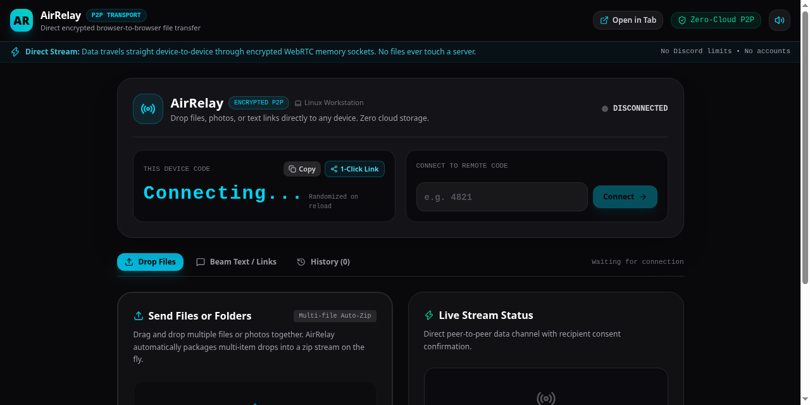

# 🌐 AirRelay

> **Zero-Setup, Zero-Cloud Cross-Device File Transport**  
> Send unlimited files and clipboard notes directly between any phone, laptop, or PC over encrypted peer-to-peer WebRTC sockets. No accounts, no compression, and no file size limits.

[](https://robfernan.github.io/air-relay/)
[](https://bun.sh)
[](https://robfernan.github.io/air-relay/)
[](https://github.com/robfernan/air-relay)
[](LICENSE)

<br/>

<p align="center">
  
</p>

---

### 🔥 Why AirRelay?

Sending a file from your phone to your PC or to a friend shouldn't require uploading it to a cloud server:
- **Discord:** Caps you at 10–25 MB unless you pay for Nitro, and aggressively compresses media.
- **AirDrop / Quick Share:** Locked to Apple or Google hardware silos.
- **Google Drive / WeTransfer:** Requires logins, creates permanent server copies, and forces you to wait for a 2-step upload/download loop.

**AirRelay streams directly device-to-device:**
- **Zero Cloud Storage:** Data travels directly through an end-to-end encrypted WebRTC memory socket.
- **Multi-File Batch Auto-Zip:** Select multiple photos or files at once; AirRelay packages them into a compressed `.zip` stream on the fly.
- **Beam Text & Links:** Dedicated instant clipboard tab to beam URLs, notes, and passwords across devices without creating files.
- **Safety First (Accept / Decline):** Recipients review incoming file names and sizes before downloading, with automatic warnings for executable files (`.apk`, `.exe`, `.sh`).
- **Unlimited File Size:** Built-in streaming backpressure flow control prevents browser memory crashes on multi-GB transfers.
- **Instant 1-Click Pairing:** Share a direct link or enter a 4-digit code to connect in seconds.
- **Android Native Share Sheet:** Install as a PWA, and AirRelay registers directly into Android's native "Share..." menu.
- **Universal Cross-Platform:** Works seamlessly between Linux, Windows, macOS, Android, and iOS.

---

### 🚀 How It Works

1. Open **[AirRelay](https://robfernan.github.io/air-relay/)** on your sending device.
2. Share the 4-digit code (or click **1-Click Link** to copy a direct pairing URL).
3. Open the link or enter the code on the receiving device.
4. Drop your file(s) or beam text. The recipient accepts, and the payload streams directly into their browser memory.

---

### 🧩 3 Ways to Use AirRelay

| Platform | How to Run | Best For |
| :--- | :--- | :--- |
| **Instant Web App** | Open [robfernan.github.io/air-relay](https://robfernan.github.io/air-relay/) | Any device with zero install |
| **Mobile PWA** | Open URL $\rightarrow$ Tap **"Add to Home Screen"** | Android / Moondrop / iOS native share sheet integration |
| **Desktop Extension** | Load `dist/` in Chrome/Edge (`chrome://extensions`) or Firefox (`about:debugging`) | Desktop users wanting 1-click toolbar access and "Open in Tab" |

---

### 🗺️ Product Roadmap

- [x] **Zero-Cloud Direct Stream**: High-speed memory pipe using WebRTC SCTP DataChannels.
- [x] **Global STUN Traversal**: Connect across different Wi-Fi and mobile 5G/cellular networks.
- [x] **1-Click Shareable URL**: Auto-pair devices via URL parameters (`?join=XXXX`).
- [x] **Streaming Backpressure Control**: Buffer-aware queue monitor preventing browser crashes on multi-GB transfers.
- [x] **Safety Confirmation Gateway**: Explicit Accept/Decline modal with executable file warnings.
- [x] **Multi-File Batch Auto-Zip**: Drag and drop multiple files together with in-memory zip packaging.
- [x] **Instant Text / Link Beam**: Direct clipboard note transfer with 1-click copy.
- [x] **Session Transfer Audit History**: Live log tracking sent and received files.
- [x] **Dual Desktop Browser Extension**: Chrome Manifest V3 and Firefox Gecko compatibility.
- [x] **Android Web Share Target**: Appear natively in Android's system share menu.
- [x] **Offline-First PWA**: Auto-updating service worker for standalone mobile use.
- [ ] **Local Subnet Proximity Discovery**: Auto-detect peers active on the same local Wi-Fi without needing a code.
- [ ] **Client-Side AES-GCM 256 Passphrase**: Optional optical/network password encryption for sensitive documents.

---

### 🛠️ Developer Quickstart

Built natively with **Bun + Vite + React 19 + TypeScript**:

```bash
# Clone
git clone https://github.com/robfernan/air-relay.git
cd air-relay

# Install dependencies (Sub-second with Bun)
bun install

# Start local development server
bun dev --host

# Build production bundle (generates Web, PWA, and Extension outputs)
bun run build
```

---

### 📜 License

MIT License • Built by [robfernan](https://github.com/robfernan).
