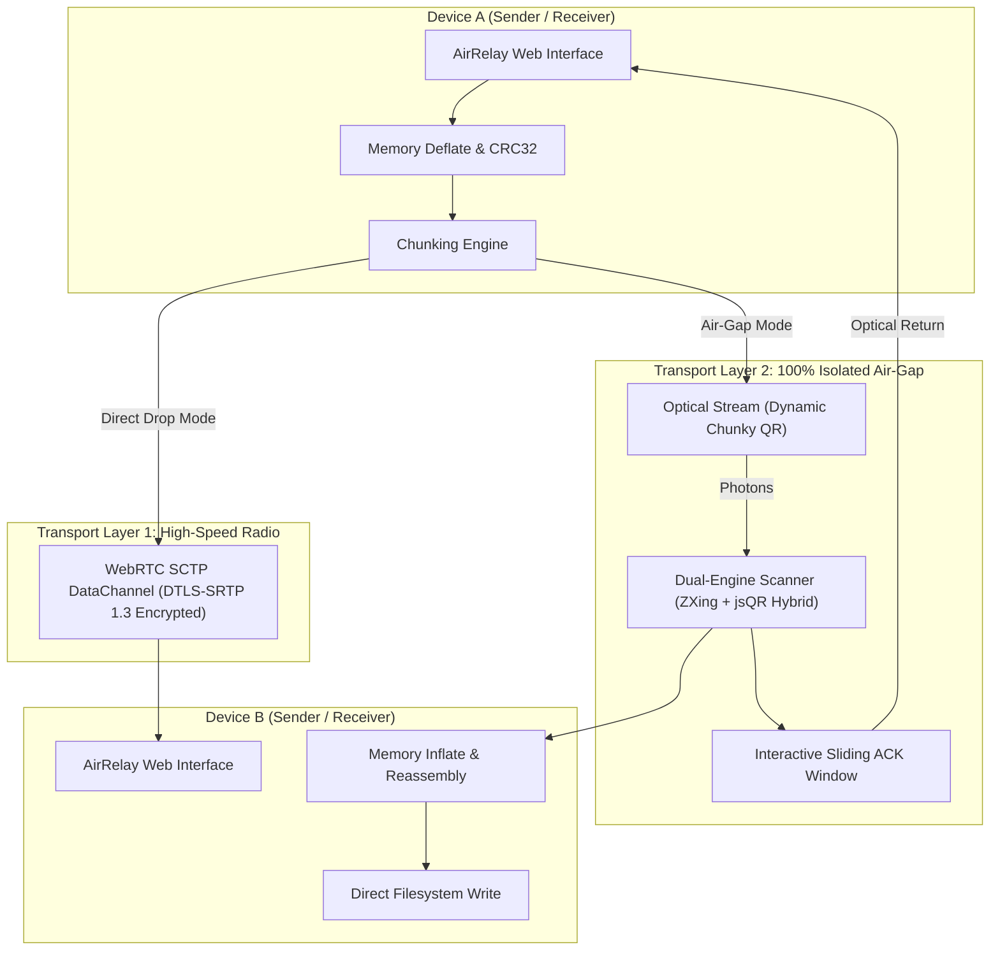

# 🌐 AirRelay

> **Enterprise-Grade Zero-Trust Peer-to-Peer & Air-Gapped Optical File Transport**  
> High-performance browser-to-browser transmission featuring direct WebRTC DataChannels and bidirectional optical screen-to-camera streaming.

[](LICENSE)
[](https://bun.sh)
[](https://github.com/robfernan/air-relay)
[](https://github.com/robfernan/air-relay)

---

## 🏛️ System Architecture

AirRelay is engineered for security professionals, field engineers, and privacy-conscious organizations requiring reliable file transfer across heterogeneous environments without relying on third-party cloud infrastructure.



---

## ⚡ Transport Engines

### 1. Direct AirDrop (WebRTC P2P DataChannel)
- **Zero-Camera / High Bandwidth**: Ideal for devices on the same Wi-Fi, mobile hotspots, or direct network connections.
- **Pairing**: 4-digit ephemeral codes (e.g., `4821`) negotiate direct peer connection via ICE/STUN without exposing credentials.
- **Throughput**: Streams binary buffers directly through SCTP sockets in 16 KB chunks at maximum interface speed.
- **Privacy**: End-to-end encrypted; data never touches a server or disk intermediary.

### 2. Optical Air-Gap (Screen-to-Camera Photonic Flow)
- **Zero Radio / 100% Physical Air-Gap**: Operates with Wi-Fi, Bluetooth, cellular, and USB cables completely disabled.
- **Dual Optical Decoders**: Combines `jsQR` with `@zxing/library` to overcome screen glare, high-frequency moiré patterns, and fixed-focus webcams.
- **Interactive Sliding-Window ACK**: Receiver continuously generates inverted optical ACK frames indicating missing packet indices for selective retransmission.
- **Adaptive Chunky Sizing**: Supports 180B–450B chunks to accommodate budget laptop webcams, audio DAPs (e.g., Moondrop MIAD01), and high-end smartphones.

---

## 📊 Protocol Specifications

### Optical Frame Schema

```typescript
// 1. Session Announcement (Sender -> Receiver)
interface InitFrame {
  t: 'INIT';
  id: string;        // 6-character session ID
  name: string;      // Filename
  size: number;      // Uncompressed byte size
  compSize: number;  // Deflate compressed byte size
  total: number;     // Total packet chunk count
  win: number;       // Sliding window batch size
  mime: string;      // Content MIME type
  crc: number;       // IEEE 802.3 CRC32 checksum
}

// 2. Data Packet Frame (Sender -> Receiver)
interface DataFrame {
  t: 'DATA';
  id: string;        // Session ID
  idx: number;       // Packet index (0-based)
  data: string;      // Base64 compressed payload
  crc: number;       // Packet CRC32
}

// 3. Selective Flow Control ACK (Receiver -> Sender)
interface AckFrame {
  t: 'ACK';
  id: string;        // Session ID
  got: number[];     // Successfully decoded indices
  missing: number[]; // Dropped indices requiring retransmission
  next: number;      // Next contiguous stream pointer
}

// 4. Session Finalization (Receiver -> Sender)
interface FinFrame {
  t: 'FIN';
  id: string;
  status: 'COMPLETE';
}
```

---

## 🔐 Enterprise Threat Model & Security Posture

| Vector | AirRelay Defense |
| :--- | :--- |
| **Man-In-The-Middle (MITM)** | WebRTC channels utilize mandatory DTLS encryption. Optical transfers are physically bounded by line-of-sight. |
| **Data Retention** | All file slicing, compression, reassembly, and decompressions occur exclusively in ephemeral client memory (`Uint8Array`). |
| **Network Snooping** | Optical Air-Gap mode operates in hardware Airplane Mode with all radio interfaces unpowered. |
| **Data Corruption** | Dual checksum validation: per-packet IEEE 802.3 CRC32 + full file integrity verification prior to disk write. |

---

## 🚀 Quickstart & Development

AirRelay is built natively with **Bun**:

```bash
# Clone the repository
git clone git@github.com:robfernan/air-relay.git
cd air-relay

# Install dependencies
bun install

# Start local network development server
bun dev --host

# Run test suite (Verifies CRC32, Base64, and Sliding Window simulation)
bun test

# Build production bundle
bun run build
```

---

## 🧩 Browser Extension Mode

AirRelay includes a native **Chromium Manifest V3** configuration:

1. Build the production output:
   ```bash
   bun run build
   ```
2. Navigate to `chrome://extensions` (or `edge://extensions`) in your browser.
3. Enable **Developer mode** (top-right switch).
4. Click **Load unpacked** and select the `dist/` directory.

---

## 📜 License

Distributed under the **MIT License**. Created by [robfernan](https://github.com/robfernan).
